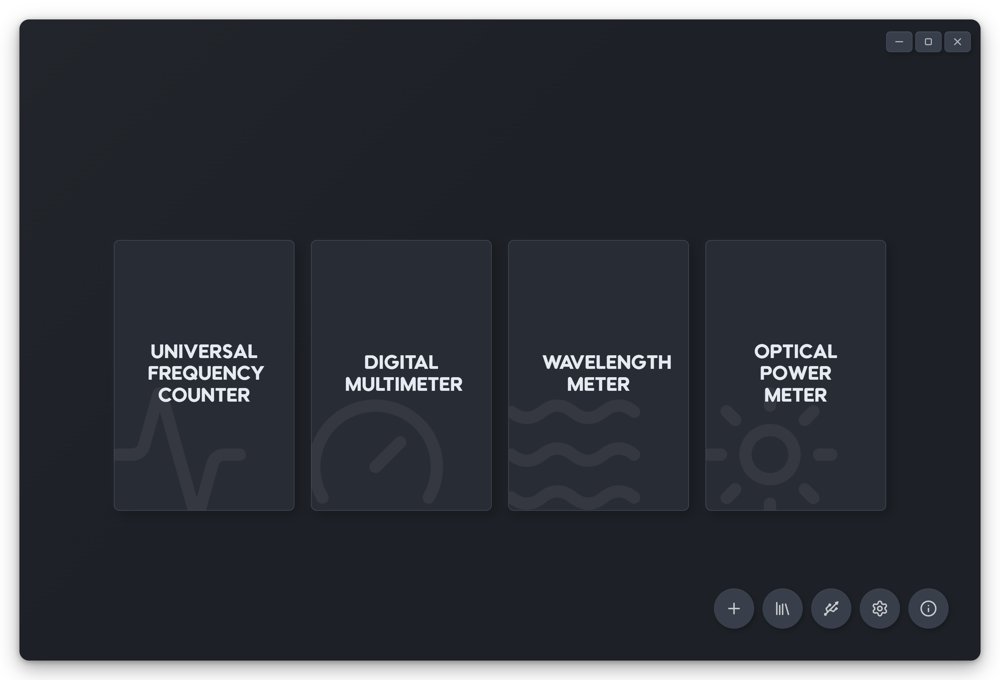
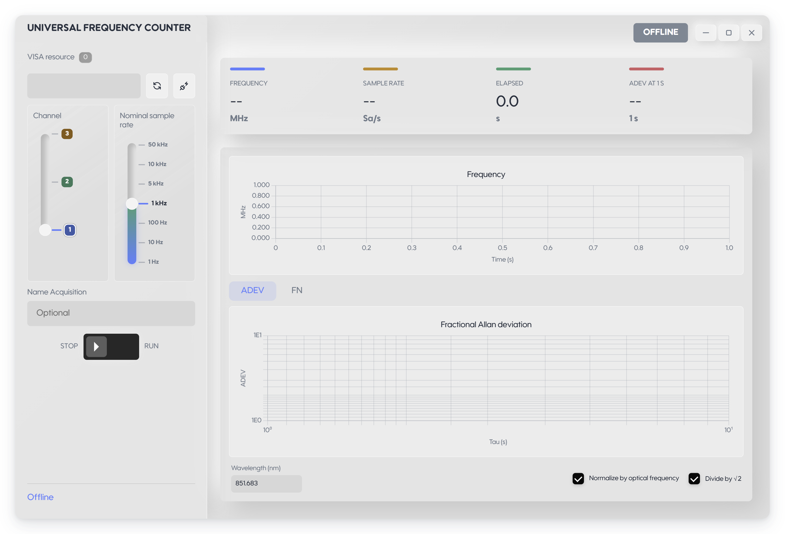
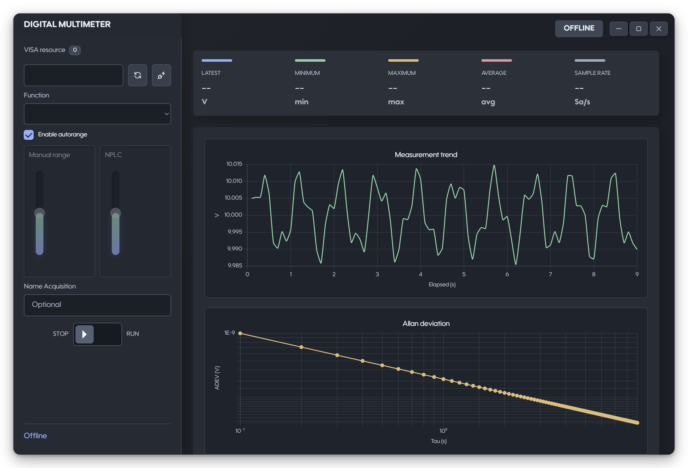
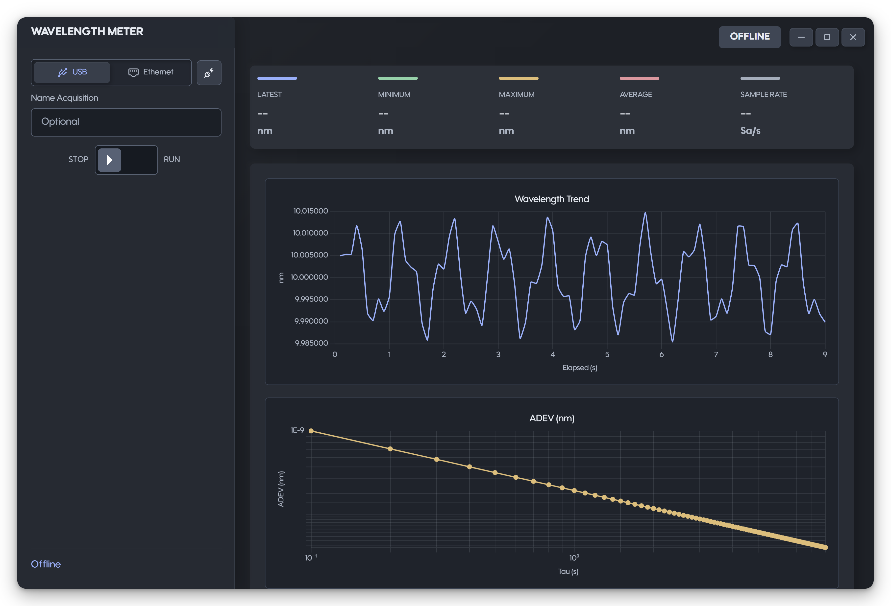

# OpenUFC

> 面向激光实验室的测量平台：频率计、数字万用表、光功率计与波长计，在同一个 Windows 桌面客户端里完成采集、分析与归档。

[](https://github.com/ThunderWe1/OpenUFC)
[](https://github.com/ThunderWe1/OpenUFC)
[](https://github.com/ThunderWe1/OpenUFC)
[](LICENSE)
[](https://github.com/ThunderWe1/OpenUFC/releases/latest)

OpenUFC 是一个 Electron + Python 的桌面测量平台：界面负责曲线与交互，本机 Python 服务负责 VISA 通信、采集线程、记录落盘与 Allan 偏差计算，两者通过本机 HTTP/SSE 通信。四类常用仪器共用同一个启动器、录制库、导出流程与主题设置。

## 特性

- **四类仪器**：Keysight/Agilent 53220A/53230A 频率计；34410A/34411A/34460A/34461A/34465A/34470A 数字万用表；Thorlabs PM 系列光功率计（TLPMX）；Bristol 671/771 波长计（Telnet-SCPI，支持 USB 虚拟网口与物理网口）。
- **实时分析**：频率、电压/电流/电阻、光功率、波长的实时趋势，分数 Allan 偏差（ADEV）与频率噪声谱（FN，单边 Welch PSD）；段长、窗函数、重叠率、对数/线性坐标均可调。
- **统一录制库**：每次采集写入一个 `.lmp` 文件，库内直接预览波形与 ADEV，按需导出 CSV；记录内含测量设置与分段边界，重启或中途丢数后的分析仍然成立。
- **设备发现**：USB/LAN VISA 资源枚举与 Bristol 虚拟网口识别；识别不了的设备单独归类，不会静默消失。
- **错误可见**：可恢复问题用黄色状态提示，致命错误弹出带操作、仪器与技术细节的对话框，并发与重复错误合并排队。
- **外观**：Light / Dark / Auto 三种模式，Auto 跟随 Windows 主题实时切换；最大化填满工作区，还原时保留窗口圆角与边距。
- **便携分发**：Windows x64 便携 EXE 内置 Electron、Python 运行时与全部依赖，目标机器无需安装 Python 或 Node.js。

## 截图

<p align="center">
  
</p>
<p align="center">
  
  
  
</p>

> 截图取自开发环境的界面预览，仪器当时处于离线状态。

## 下载

前往 [Releases](https://github.com/ThunderWe1/OpenUFC/releases) 下载最新的 `OpenUFC-0.1.0-win-x64.exe`，双击运行即可。

- 系统：Windows 10 / 11（x64）
- 体积：约 97 MB，便携版启动时把运行时解压到系统临时目录
- 依赖：仪器厂商驱动仍需单独安装 —— Keysight/NI VISA（USB 仪器）、Thorlabs OPM/TLPMX（光功率计）、Bristol USB 网卡驱动（USB 模式波长计）
- 数据：设置与录制默认放在 `%APPDATA%\OpenUFC\`，与 EXE 分离，替换或移动 EXE 不会丢配置

> 便携版启动会先显示解压卡片，再进入等待动画，直到测量服务就绪。EXE 未签名，首次运行可能被 SmartScreen 拦截，选择「更多信息 → 仍要运行」。

## 使用

1. **选择子应用**：启动后进入启动器，点选频率计、数字万用表、光功率计或波长计。
2. **连接仪器**：在页面左侧填写 VISA 资源，或点刷新按钮枚举设备；USB 图标旁的 **Devices** 页面列出所有已识别仪器，计数徽标只统计已连接且型号受支持的设备。
3. **设置采集**：频率计选择通道与标称采样率（1 Hz – 50 kHz），DMM 选择测量功能与量程，光功率计选择显示单位（W / mW / dBm），波长计选择 USB 或 Ethernet。
4. **开始录制**：点 RUN 开始，实时曲线、统计与 ADEV 同步更新；停止时后端先排空仪器缓冲再落盘，不会把停止瞬间的异常读数写进文件。
5. **查看与导出**：**Library** 列出录制文件，可预览波形/ADEV 并导出 CSV；录制目录由 `platform.library_dir` 指定。
6. **外观与重置**：右下角齿轮进入全局设置，Light / Dark / Auto 即时预览，Save 后持久保存；Reset 只删除当前 `config.json`，不会动录制文件。

### 配置文件

| 内容 | 位置 |
| --- | --- |
| 开发运行 | 项目根目录 `config.json`，首次运行自动生成，已加入 `.gitignore` |
| 便携 EXE | `%APPDATA%\OpenUFC\config.json` |
| 录制文件 | 默认 `%APPDATA%\OpenUFC\runs`，可用 `platform.library_dir` 改到其他目录 |

## 从源码构建

需要 Windows x64、Python 3.12+（含 `py` 启动器）与 Node.js 20+。

开发运行：

```powershell
py -m venv .venv
.\.venv\Scripts\python.exe -m pip install -r requirements.txt
npm install
npm run dev
```

Windows 下也可以双击 `Start-OpenUFC.cmd`，它等价于 `npm run dev`，启动失败时保留控制台。

打包便携 EXE（需要单独的构建环境）：

```powershell
py -m venv .build-venv
.\.build-venv\Scripts\python.exe -m pip install -r requirements-build.txt
npm ci
npm run build:win
```

产物为 `dist\OpenUFC-0.1.0-win-x64.exe`，只分发这一个文件即可：Electron、Python、依赖、图标与字体都已包含。图标可在 `assets/icon.svg` 修改，`npm run build:icon` 会重新生成 PNG、ICO 与启动卡片。

只调试后端：`py main.py --server --port 0`。检查打包后的界面：`dist\OpenUFC-0.1.0-win-x64.exe --smoke`，自检使用独立的临时设置目录。

## 项目结构

```text
laser_platform/
  server.py        本机 HTTP/SSE 服务
  ufc/             频率计采集、记录与 ADEV
  dmm/             数字万用表模型、采集与 VISA 客户端
  opm/             Thorlabs 光功率计与 TLPMX 适配
  wlm/             Bristol 波长计与 Telnet-SCPI 客户端
electron/          Electron 主进程、preload 与冒烟自检
ui/                启动器与各子应用界面
assets/            图标、启动卡片与静态资源
scripts/           构建脚本（PyInstaller 后端、图标生成）
docs/              技术说明与截图
```

## 技术说明

频率计的停止/排空时序、`.lmp` 记录格式与分段边界、采样率预设与实测吞吐、各仪器的 SCPI 细节，以及 2026-10-31 的 VISA 速率验证结果，见 [docs/technical-notes.md](docs/technical-notes.md)。

## 许可

MIT，见 [LICENSE](LICENSE)。
